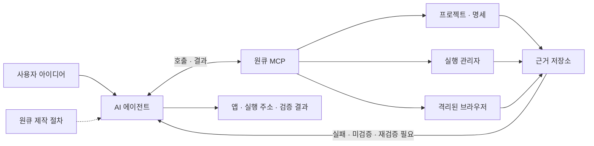

# 원큐 MCP — 제품 납품 검증 v0.3

아이디어를 앱으로 만드는 AI 에이전트에 **프로젝트 조회, 실행, 브라우저 조작, 검증 근거**를 제공하는 로컬 MCP 서버입니다. 기존 원큐 바이브코딩의 요구 파악 → 범위 설정 → 구현 → 검증 → 전달 절차를 `build_app` 프롬프트와 `onequeue://guide` 자료로 제공합니다.

코드 작성과 수정 판단은 연결된 에이전트가 담당합니다. 원큐 스킬의 제품 납품 기준을 MCP 명세·근거·배포 판정에 연결합니다. 배포 실행은 호스트의 전문 도구가 맡습니다.



## 바로 사용하기

요구 환경: **Node.js 24 이상**, 브라우저 검증 시 **Microsoft Edge**. 기본 프로젝트 설정은 현재 폴더의 SEVEN과 Windows Edge에 맞춰져 있습니다.

추가 예제 앱은 [`../apps/hankan/`](../apps/hankan/README.md)의 **한 칸**입니다. 프로젝트 ID는 `hankan`입니다. Codex 연결 상태는 `codex mcp get onequeue --json`으로 확인할 수 있습니다. 활성 MCP가 있으면 연결된 도구로 작업하세요. 데모·과거 앱 검증 스크립트는 별도 서버를 시작하므로 활성 서버와 함께 실행하지 않습니다. 코드 업데이트 후 연결된 서버 버전은 다음 정상 재연결부터 바뀝니다.

독서 기록 앱 **책갈피**는 [`../apps/bookmark/`](../apps/bookmark/README.md)에 있습니다. 프로젝트 ID는 `bookmark`입니다. 기존 `verify:*` 스크립트는 당시 명세와 검증을 재현하는 자료이며 v0.3 출시 인증이나 자동 마이그레이션 도구가 아닙니다. 새 검증에는 아래 정책과 [검증 작성 지침](../references/verification.md)을 적용하세요.

이 디렉터리에서:

```powershell
npm ci
npm test
npm run demo
npm run client-config -- --write
```

- `npm test`: 원큐 자체의 상태·취소·경로·브라우저·MCP 통신 통합 테스트입니다. 별도 임시 프로젝트를 사용합니다.
- `npm run demo`: 실제 stdio MCP 클라이언트로 SEVEN 테스트·빌드·브라우저 흐름을 실행합니다. 별도 DB의 합성 계정으로 회원가입·새로고침 후 로그인 유지를 확인합니다. 기존 제작 명세가 데모 명세와 다르면 덮어쓰지 않고 중단합니다.
- 데모 결과: SEVEN 프로젝트의 `.onequeue/demo-report.json`, `.onequeue/artifacts/*.png`.
- `client-config`: 이 컴퓨터의 절대 경로가 들어간 `mcp-client.local.json`을 생성합니다. 호스트 앱의 설정을 자동 변경하지 않습니다.
- `npm run status -- --project promise-release`: 활성 MCP를 유지한 채 최신 코드로 상태를 읽습니다. 상태 파일·잠금·작업을 변경하지 않습니다. `--full`로 상세 근거를 출력합니다.
- `npm run verify:regression-detectors`: 이번 감사에서 발견한 실제 앱 결함을 격리 환경에서 재현하고 검사 도우미가 거절하는지 확인합니다. 앱의 출시 통과를 뜻하지 않습니다. 해당 앱을 수정하면 이 과거 결함 재현 스크립트도 갱신하세요. 기본 테스트는 독립된 재현 사례를 사용합니다.

MCP 클라이언트의 서버 등록 화면에서 생성된 JSON의 `command`와 `args`를 사용하세요. `mcpServers` JSON 형식을 지원하는 클라이언트는 해당 항목을 자신의 설정에 합칠 수 있습니다. 클라이언트마다 설정 형식은 다릅니다.

직접 실행 명령은 `node src/index.mjs`이며, MCP 호스트에는 **node 실행 파일과 index.mjs 절대 경로**를 등록합니다. npm의 안내 출력이 프로토콜 출력에 섞이지 않도록 호스트 명령으로 `npm start`를 사용하지 마세요. 직접 실행 후 아무 출력 없이 대기하는 것은 정상입니다. MCP 호스트가 표준 입력으로 요청을 보냅니다.

프롬프트 선택 기능이 있는 호스트에서는 `build_app`을 선택하고 `projectId: seven`과 아이디어를 입력합니다. 그렇지 않으면 에이전트에게 다음처럼 요청하세요.

> 원큐의 onequeue://guide를 읽고 seven 프로젝트를 조회해 주세요. 필요한 코드를 수정한 뒤 등록된 테스트와 격리된 미리보기로 검증하고, 최신 근거가 있는 결과만 완료로 보고해 주세요.

## 도구 14개

| 도구 | 핵심 입력 | 동작 |
| --- | --- | --- |
| `inspect_project` | 선택적 `projectId` | 미지정 시 등록 목록, 지정 시 구조·설정·소스 지문 |
| `save_build_brief` | `projectId`, `expectedVersion`, `brief` | 버전 충돌을 확인하고 명세 저장 |
| `start_preview` | `projectId`, `requestKey` | 별도 DB와 임의 루프백 포트로 HTTP 서버 실행 |
| `stop_preview` | `projectId`, `previewId` | 원큐 미리보기와 연결된 브라우저 종료 |
| `run_checks` | `projectId`, `requestKey`, `checkIds` | 등록된 Node 명령을 순차 실행 |
| `get_job_result` | `projectId`, `jobId`, 선택적 `cursor` | 작업 상태·증분 로그·결과 조회 |
| `cancel_job` | `projectId`, `jobId` | 대기 또는 실행 작업 취소 |
| `browser_action` | `projectId`, `action`, 액션별 입력 | 브라우저 열기·조작·화면 수집·닫기 |
| `browser_assert` | `projectId`, `sessionId`, `criterionId` | 저장된 완료 조건의 기대 결과 확인 |
| `get_project_status` | `projectId`, `detail: summary 또는 full` | 기본 요약 또는 조건별 상세 근거와 완료 여부 |
| `record_review` | 검토자·요약·자료 경로·`provenance` | 수동 검토 판단과 관찰 환경·참여자·한계 기록 |
| `record_finding` | `findingId`, 심각도·설명·완료 조건 ID | 발견한 결함을 등록하고 중대 결함의 출시 차단 |
| `resolve_finding` | `findingId` | 등록 이후 새 실행 근거가 통과한 결함만 해제 |
| `verify_deployment` | 주소·버전·커밋·빌드 해시 | 실제 배포 응답과 소스 연결 |

모든 도구는 JSON 텍스트와 `structuredContent`를 반환합니다. 잘못된 프로젝트, 명세 버전 충돌 등의 호출 실패는 `isError: true`와 `error.code`, `error.message`를 반환합니다. 비동기 테스트 실패는 호출 오류가 아니라 작업 상태 `failed`로 확인합니다. 브라우저 기대 조건 불일치도 결과 `failed`로 반환합니다.

같은 요청 재전송은 같은 `requestKey`를 사용합니다. 같은 키에 다른 작업을 지정하면 오류입니다. 완료된 작업을 다시 실행하려면 **새 키**를 사용하세요. 이 작업 ID와 대기열은 원큐 애플리케이션의 기능이며 MCP Tasks 확장을 요구하지 않습니다.

## 명세와 완료 조건

처음 저장할 때 `expectedVersion: 0`, 수정할 때 현재 명세의 버전을 사용합니다.

```json
{
  "projectId": "seven",
  "expectedVersion": 0,
  "brief": {
    "target": "prototype",
    "title": "회원가입 흐름 검증",
    "objective": "계정을 만들고 로그인된 앱을 확인한다",
    "criteria": [
      {
        "id": "AC-api",
        "description": "기존 모델 및 API 테스트 통과",
        "required": true,
        "verification": { "kind": "check", "checkId": "test" }
      },
      {
        "id": "AC-signup",
        "description": "회원가입 후 앱 본문 표시",
        "required": true,
        "verification": {
          "kind": "browser",
          "assertion": { "kind": "visible", "selector": ".main-shell" }
        }
      }
    ]
  }
}
```

브라우저 조건은 `visible`, 정확한 `text`, `count`, 경로+쿼리가 일치하는 `url`, `reachable`, `focused`, `contrast`, `no_overflow`를 지원합니다. `text`는 관찰값 앞뒤 공백을 제거해 비교합니다. 확인은 최대 5초 동안 재시도합니다. `journey`는 뷰포트·클릭·입력·키보드·대기·새로고침·관찰을 저장된 순서로 실행합니다.

`browser_action`은 `open`, `navigate`, `reload`, `viewport`, `click`, `fill`, `select`, `check`, `snapshot`, `close`를 지원합니다. `open`에는 준비된 `previewId`, 나머지에는 `sessionId`가 필요합니다. `fill`/`select`는 `selector`와 `value`, `click`/`check`는 `selector`를 사용합니다. selector는 `button:has-text("회원가입")`, `[name="username"]` 같은 Playwright locator 문자열입니다. `snapshot`은 현재 뷰포트 이미지의 로컬 경로·MCP 리소스 URI와 접근성 스냅샷을 반환합니다.

브라우저 세션은 최대 6개이며 각각 별도 쿠키·저장소를 가집니다. 클릭 성공이나 스크린샷 생성은 완료 조건 통과를 뜻하지 않습니다. `browser_assert`는 명세에 저장된 조건만 확인하며, 호출 중 기대값을 임의로 바꿀 수 없습니다. 단일 화면 조건은 그 화면에 이르기까지의 전체 흐름을 증명하지 않습니다. 복수 단계 보장은 `journey` 또는 실행 사례 보고서를 남기는 등록 테스트로 표현하세요.

## 상태와 근거

- 검증 작업: `queued → running → succeeded / failed / timed_out / cancelled`.
- 미리보기: `queued → starting → ready → stopped / failed / timed_out / cancelled`.
- 종료 요청 중에는 `stopping` 또는 `cancelling`을 반환할 수 있습니다. 최종 상태까지 조회하세요.
- 서버 재시작 시 완료되지 않은 기록은 `interrupted`로 전환하며 자동 재실행하지 않습니다.
- 완료 조건: `passed`, `failed`, `unverified`, `stale`.
- verified는 선택한 납품 수준의 완료 여부입니다. 기본 target은 deployed이며 로컬 테스트 통과만으로 완료되지 않습니다.

실행 근거에는 명세 버전, 소스 SHA-256 지문, 시각, 실제 관찰 또는 프로세스 종료 결과를 저장합니다. 지문은 설정의 `sources`에 포함된 파일 내용과 실행 설정으로 계산하므로 미커밋·새 파일도 반영합니다. 파일 변경, 명세 변경, 실행 전후 코드 불일치는 이전 결과를 현재 완료 근거로 사용하지 못하게 합니다. 미리보기는 시작 시점의 지문을 사용하므로 코드를 수정한 뒤 다시 시작해야 합니다.

일반 실행에서는 시작·종료 시점을 비교합니다. 실행 중 파일이 변경됐다가 정확히 원복되는 모든 경우를 감지하거나 실행 전체를 불변 스냅샷으로 만드는 기능은 없습니다. 소스 편집과 검증을 동시에 진행하지 마세요. 런타임 의존성 내용, OS, 외부 서비스까지 지문으로 고정하지는 않습니다. 사용하는 lockfile을 `sources`에 포함하세요.

상태와 로그는 프로젝트 `.onequeue/state.json`에 저장합니다. 로그는 작업당 최근 64 KiB 수준으로 제한하고 긴 단일 행을 생략합니다. 커서는 문자 오프셋이며, 잘린 범위를 요청하면 `truncated: true`입니다. 일반적인 비밀값 패턴을 마스킹하지만 모든 문자열을 비밀로 식별할 수는 없습니다. 화면·텍스트·로그에는 합성 데이터만 사용하세요. 이미지에서 비밀번호 입력칸은 가립니다.

## 다른 프로젝트 등록

`projects.json`을 복사·수정하고 `node src/index.mjs --config <절대경로>`로 실행합니다. 설정은 시작 시 읽으며 변경 뒤 재시작합니다. 프로젝트 ID와 루트 경로는 중복할 수 없습니다.

- `root`: 설정 파일 기준 상대 경로 또는 절대 경로.
- `sources`: 지문에 포함할 파일/디렉터리 목록. `node_modules`, `.git`, `.onequeue`, `dist`, `test-results` 하위는 제외합니다. 파일 20,000개/100 MiB까지 지원합니다.
- `checks`: Node 실행 인자 배열과 시간 제한. 셸 문자열을 받지 않으며 항상 현재 Node 실행 파일로 실행합니다. 예: `{ "args": ["--test", "tests/*.test.mjs"], "timeoutMs": 60000 }`.
- `checks.<id>.reportPath`: 현재 실행 ID와 사례별 결과를 담을 JSON 경로. 빌드 이외의 출시 검증에는 실행 사례 보고서가 필요합니다. 형식과 도우미는 [검증 작성 지침](../references/verification.md)을 참고하세요.
- `lineage`: 같은 제품의 `local`·`hosted`·`archived` 변형과 대체 관계. `product`, `variant`, 선택적 `supersedes`로 데이터·코드의 기준 위치를 구분합니다.
- `browserChannel`: `msedge`, `chrome`, `chromium`. Chromium은 이 디렉터리에서 `npx playwright install chromium`으로 별도 설치할 수 있습니다.
- `preview`: 선택 항목. HTTP 서버 팩토리 모듈과 export 이름, 상태 확인 경로.

미리보기 모듈은 다음 인터페이스를 제공해야 합니다. 원큐가 직접 루프백의 임의 포트에서 listen하므로 팩토리 내부에서 listen하지 않습니다.

```js
export async function createApp({ database, origin }) {
  // database는 원큐가 생성한 별도 파일 경로입니다.
  // 이 경로를 실제 저장소에 사용하고, 기존 운영 저장소를 연결하지 않습니다.
  return http.createServer(handler);
}
```

SEVEN의 `createApp`은 이 계약을 이미 지원합니다. 임의 프레임워크의 `npm run dev`를 자동으로 격리하는 범용 어댑터는 아직 없습니다. 기존 Node 테스트는 별도 프로세스에서 실행하고, SEVEN 브라우저 테스트에는 이 패키지의 Playwright 모듈 경로를 전달합니다.

## 실행 범위와 제한

추가 검증 앱 **[우리의 약속](../apps/promise/README.md)**은 친구방의 7일·4회 약속, 인증·반응, 검토·공동 순위, 다음 시즌을 구현합니다. npm run verify:promise 명령으로 실제 stdio MCP를 통해 규칙/API·브라우저·저장 완료 조건을 확인합니다. 사용자용 로컬 앱은 apps/promise에서 npm start 후 http://127.0.0.1:4190 으로 열 수 있습니다.

- **신뢰하는 로컬 프로젝트 전용**입니다. 등록 명령도 코드 실행이며 현재 사용자 권한을 가집니다. 셸 입력 제한과 경로 검사는 OS 샌드박스가 아닙니다.
- 도구 호출로 프로젝트 경로·실행 명령을 추가하지 않습니다. 호스트가 지정한 설정 파일만 사용합니다. 경로 이탈과 프로젝트 내부 심볼릭 링크/Windows junction은 거절합니다.
- 각 프로젝트에 단일 실행 소유자 잠금을 사용합니다. 활성 서버가 있으면 두 번째 서버는 시작하지 않습니다. 살아 있는 다른 PID로 잘못 추정될 가능성이 있는 오래된 잠금은 임의로 깨지 않습니다.
- 체크 프로세스는 감독 프로세스 아래 실행됩니다. 취소·시간 초과 시 프로세스 트리를 종료하고, MCP 연결이 사라져도 감독 프로세스가 정리합니다. 명령이 프로세스 트리 밖으로 의도적으로 분리하는 동작까지 격리하지는 않습니다.
- 미리보기는 실행별 `.onequeue/<job-id>.sqlite`를 사용하며 기존 SEVEN DB를 열지 않습니다. 다른 프로젝트도 팩토리가 전달된 DB 경로를 준수해야 합니다.
- 브라우저는 원큐 미리보기 origin만 요청하며 외부 redirect, WebSocket, Service Worker, 다운로드를 제한합니다. 외부 폰트·외부 API·HMR을 요구하는 화면은 이 제한에 맞춘 별도 로컬 검증 환경이 필요합니다. 이것은 악성 웹 코드에 대한 완전한 네트워크 샌드박스가 아닙니다.
- 보존된 DB·화면·기록은 자동 삭제하지 않습니다. 필요한 기록을 보관한 뒤 서버가 종료된 상태에서 `.onequeue`를 관리하세요. 활동 중 삭제하면 안 됩니다.
- 배포 실행·OAuth 연결은 호스트의 전문 도구가 담당합니다. 원큐는 등록 HTTPS 배포 주소의 상태·빌드 해시를 직접 확인하고 배포 영수증 메타데이터와 검토 근거를 연결합니다. 로컬 브라우저의 외부 사이트 접근 제한은 유지합니다.

## v0.3 출시 판정

- requirements에 요구사항 ID와 acceptance를 등록하고 criterion.requirementIds로 연결합니다. 제외 항목은 scopeEvidence로 근거를 남깁니다. 같은 ID의 설명·기준 변경도 scopeChanges에 남겨야 합니다.
- designBrief는 제품별 핵심 행동, 레이아웃, 이전 앱과의 차이를 설명합니다.
- target은 prototype, release, deployed입니다. 명시적으로 요청한 시제품만 prototype으로 설정합니다.
- localVerified는 필수 비운영 검증 통과, releaseReady는 요구사항 및 기능·디자인·접근성·보안·빌드·운영 영역까지 통과한 상태입니다.
- deployedVerified는 현재 소스의 배포 확인과 production 단계 사용자 흐름 검증까지 필요합니다.
- prototype 이외의 기능·보안·빌드는 수동 review로 통과시킬 수 없습니다. 빌드 외 check는 이번 실행 ID와 일치하는 사례별 보고서가 있어야 하며 실패·생략 사례나 빈 보고서는 통과하지 않습니다.
- capabilities로 실제 기능을 선언합니다. 반응형 앱은 모바일 행동·대비·키보드, 자동 갱신은 상태 갱신·포커스 유지, 시간 의존 기능은 경계 시각, 저장은 새로고침·복구, 계정·공유·내보내기는 해당 기능 검증을 요구합니다. covers 표기만으로 충족되지 않고 통과 사례 또는 journey의 관찰 결과가 필요합니다.
- 반응형 내보내기는 모바일 행동과 실제 다운로드를 같은 사례에서 확인합니다. 시간에 따라 자동 갱신되는 기능은 경계 시각과 열린 화면의 갱신을 같은 사례에서 확인합니다. 각각 별개로 통과한 태그를 합쳐 이 흐름이 검증됐다고 판단하지 않습니다.
- blocking·major finding은 재실행으로 해결을 확인할 때까지 출시를 차단합니다. 기준을 바꾸거나 기존 통과 근거를 재사용해서 해제할 수 없습니다.
- maturity는 pilot과 production을 구분합니다. production에는 운영 규모·복구 목표인 operatingEnvelope와 capacity 검증이 필요하며, 공유 앱의 운영 판정에는 실제 사용자 둘 이상의 브라우저 관찰 근거가 필요합니다.
- record_review는 reviewer·summary·artifactPaths의 파일 해시와 provenance를 기록합니다. 실제 계정·합성 계정, 사용자 확인·DB 조회·브라우저 관찰을 구분합니다. 수동 검토이며 독립 감사 인증이 아닙니다. 파일 또는 소스가 바뀌면 stale입니다.
- verify_deployment는 deploymentOrigins의 HTTPS origin만 접근하고 redirect를 따르지 않습니다. healthPath의 JSON에는 ok, release, buildHash가 있어야 합니다.
- deploymentAuth는 호스트가 정한 헤더와 환경변수 이름만 설정합니다. 비밀 값은 프로세스 환경에서 읽고 도구 인자·로그·상태 파일에는 보관하지 않습니다.
- commitSha·versionId·deploymentId는 배포 도구 영수증에서 복사합니다. 원큐가 호스팅 서비스의 커밋 서명을 독립 검증하는 것은 아닙니다.
- 이전 정책의 명세는 migration_required이며 완료로 올리지 않습니다. 과거 근거와 briefHistory는 유지하고 새 명세·정책으로 재검증합니다. 서버 코드 업데이트가 과거 기록을 자동 인증하지 않습니다.
- 기존 필수 요구사항을 삭제·제외할 때는 scopeChanges의 reason과 userEvidence가 필요합니다. target을 낮추려면 targetChangeEvidence에 사용자 변경 요청 근거를 남겨야 합니다. 근거 내용의 진실성은 호스트가 검토합니다.

운영 버전 우리의 약속은 sites/promise입니다. 기존 apps/promise는 로컬 v1 데이터 보존용이며 새 서비스와 계정·데이터를 자동 합치지 않습니다. 외부 사이트를 직접 다루는 운영 브라우저 어댑터는 아직 없으며 inspect_project에 이 제한을 표시합니다. 등록 테스트의 사실성과 명세에 빠진 기능까지 MCP가 독립적으로 증명하지는 않습니다.

## 구성

```text
src/index.mjs          stdio 진입점과 종료 처리
src/server.mjs         MCP 도구·자료·프롬프트
src/app.mjs            명세 버전과 완료 상태 집계
src/config.mjs         프로젝트·완료 조건 스키마
src/policy.mjs         기능별 검증·근거 출처 정책
src/release.mjs        정책 버전·단계별 출시 판정
src/check-report.mjs   실행 ID에 연결된 사례 보고서
src/quality-checks.mjs 모바일·포커스·시간 갱신·대비 도우미
src/store.mjs          단일 소유자·상태 저장·재시작 복구
src/jobs.mjs           순차 실행·취소·로그·요청 키
src/check-worker.mjs   연결 종료 시 명령 프로세스 정리
src/preview-worker.mjs 검증 DB를 사용하는 HTTP 서버
src/browser.mjs       세션·제한된 조작·조건 검증
src/util.mjs          경로 검사·지문·로그 마스킹
tests/                격리된 통합 테스트
scripts/demo.mjs       실제 SEVEN을 사용하는 MCP 데모
scripts/status.mjs     실행 소유권 없이 최신 정책 상태 조회
```

공식 참고: [MCP TypeScript SDK v1](https://ts.sdk.modelcontextprotocol.io/server), [Playwright BrowserContext](https://playwright.dev/docs/api/class-browsercontext). SDK 버전은 lockfile로 고정했습니다. 이 버전은 Windows의 Node 24 및 Edge 환경을 대상으로 검증합니다.
